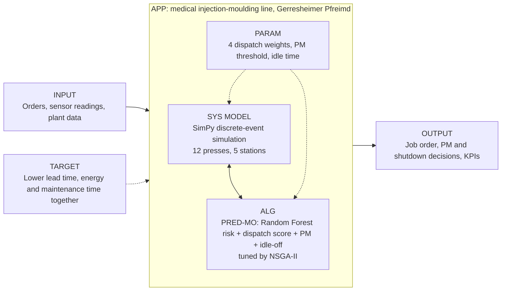

# AI-Driven Multi-Objective Optimization of a Medical Injection-Moulding Line

MDM2 Case Study: Intelligent Systems in Production (THD, WS 2026/27).
Team: Kuriakose Vettikattil Raju (team lead), Mahesh Koduri, Saurabhkumar Mahant.
Supervisor: Prof. Dr.-Ing. Hamidreza Heidari.

A simulated case study modelled on the Gerresheimer medical-plastics plant in Pfreimd. The project
compares fixed scheduling rules (FCFS, SPT, setup-aware) with a predictive, multi-objective policy
on a five-station line: drying, clean-room moulding, camera inspection, assembly and clean-room
packaging. The KPIs are lead time, energy, maintenance/downtime and scrap.

## Architecture



| Block | In this project |
|---|---|
| **Target** | Minimise lead time (order → QA release), energy per 1,000 good parts and maintenance time at the same time. On-time rate, escaped defects and OEE are guardrails: reported for every policy, not optimised. The benchmark is a tuned non-ML rule (SETUP+PM). |
| **App** | A simulated medical-plastics moulding plant modelled on Gerresheimer Pfreimd, built from public data and literature. |
| **Input** | Orders (product, quantity, due date, mould); per-press sensor readings (air/process temperature, speed, torque, tool wear); plant data (press types and power, drying, changeovers, crews, repairs, QA hold); AI4I 2020 failure data to train the risk model. |
| **Sys model** | SimPy discrete-event simulation: drying → moulding (12 presses, 8 moulds) → camera inspection → assembly → clean-room packaging, with failures, repairs, changeovers and energy use. |
| **Alg** | PRED-MO: a Random Forest predicts each press's failure risk for the next shift; a weighted dispatch score picks the next job; predictive maintenance when risk ≥ threshold; idle presses switch off. NSGA-II (Optuna) tunes it. Baselines: FCFS, SPT, SETUP, SETUP+PM. |
| **Param** | Decision parameters tuned by NSGA-II: `w_due`, `w_setup`, `w_spt`, `w_risk`, `pm_threshold`, `idle_off` ([tuned values](simulation/results/tuned.json)). Plant parameters are assumptions; the sensitivity analysis moves 10 of them to a low and a high value. |
| **Output** | Job sequence per press, maintenance and shutdown decisions, and KPIs per policy, compared on 100 unseen scenarios with paired t-tests. |

## Contents

| Path | What it is |
|---|---|
| `Proposal_Gerresheimer_Pfreimd.docx` | Phase 1 one-page proposal |
| `Presentation_Gerresheimer_Pfreimd.pptx` | Phase 1 concept presentation |
| `Progress_Presentation_Gerresheimer_Pfreimd.pptx` | Phase 2 progress presentation (Phase 1 → Phase 2) |
| `Progress_Presentation_Phase3_Gerresheimer_Pfreimd.pptx` (+ `.pdf`) | Phase 3 presentation (24 Nov): methodology, how PRED-MO works, sensitivity analysis, tests/CI, issues board. Rebuild with `tools/build_phase3_deck.py` |
| `simulation/` | SimPy model, AI4I 2020 failure-risk model, Optuna NSGA-II tuning, experiments, tests ([details](simulation/README.md)) |

## Status

The simulation is at **model v2**. It has:
- 12 presses in 3 tonnage classes and 8 moulds with limited copies;
- campaign lots, setter and maintenance crews, and press failure modes;
- energy by press drive type, OEE, camera inspection errors and GMP QA release;
- a non-ML maintenance-rule baseline;
- energy cost under a time-of-day electricity price profile;
- a one-at-a-time sensitivity analysis and a Morris screening on 10 assumed parameters;
- a live demo with a decision trace (`python -m moulding_sim.demo --trace 2`).

Still open (tracked on the [issues board](https://github.com/MaheshBhushan/Case-Study-Intelligent-Systems/issues)):
- the dashboard and demo video.

All plant parameters are synthetic and literature-based; Gerresheimer publishes no operational data.

```bash
cd simulation && uv sync && uv run pytest -q
```
