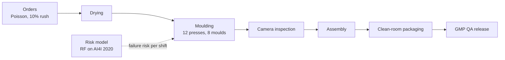

<h1 align="center">moulding-sim</h1>
<p align="center">A SimPy model of a 12-press medical injection-moulding plant. It tests whether ML-driven maintenance and tuned dispatching beat fixed rules.</p>

<p align="center">
  <a href="https://github.com/MaheshBhushan/Case-Study-Intelligent-Systems/actions/workflows/ci.yml"></a>
  
</p>

<p align="center">
  <a href="results/summary.md">Full results</a> ·
  <a href="results/paired_tests.csv">Paired tests</a> ·
  <a href="../Bibliography_Report/Bibliography_Report_Gerresheimer_Pfreimd.pdf">Bibliography report</a> ·
  <a href="../README.md">Case study</a>
</p>

<!-- HERO: add a GIF of a run (press states / queue over time) here. -->

## Overview

Injection-moulding plants for medical devices lose time and energy in three places: long GMP changeovers, unplanned press breakdowns and presses idling between lots. Fixed dispatching rules such as FCFS or shortest-processing-time do not account for any of these together.

This model uses the Gerresheimer site in Pfreimd as a public reference case. It compares five policies on the same randomised scenarios. The AI policy (`PRED-MO`) does two things:
- it triggers preventive maintenance from a Random Forest failure-risk model trained on AI4I 2020;
- it dispatches with weights tuned by Optuna NSGA-II against three objectives: lead time, energy and maintenance time.

> [!IMPORTANT]
> All plant parameters are synthetic and based on the literature. Gerresheimer publishes no operational data. The results compare policies with each other. They are not predictions for the real plant.

## Quickstart

```bash
git clone https://github.com/MaheshBhushan/Case-Study-Intelligent-Systems.git
cd Case-Study-Intelligent-Systems/simulation
uv sync --locked                           # Python 3.12, versions pinned in uv.lock
uv run pytest -q                           # 28 tests, ~15 s
uv run python -m moulding_sim.experiments  # 100 held-out scenarios -> results/summary.md
```

`experiments` reads the committed `results/tuned.json` and `results/rule.json`. It trains the risk model on first use, which downloads AI4I 2020 into `data/` and caches the model in `models/`. Options: `--seeds 100-199 --scenarios base,high --workers 8`.

<details>
<summary>Re-tune from scratch (~30 min on 8 cores)</summary>

```bash
uv run python -m moulding_sim.risk                                    # train + evaluate risk model
uv run python -m moulding_sim.optimize --train-seeds 3 --generations 12  # settings behind the committed tuned.json
```

`optimize` runs a grid search for the `SETUP+PM` rule (`rule.json`, `rule_grid.csv`). It then runs NSGA-II for `PRED-MO` (`tuned.json`, `pareto.csv`, `trials.csv`). With no flags, the defaults are 4 seeds × 10 generations, which do not reproduce the committed files.
</details>

## Model



| Part | What is modelled |
|---|---|
| Presses | 4 × 80 t all-electric, 5 × 150 t hybrid, 3 × 250 t hydraulic, each with its own busy and idle power |
| Moulds | 8 moulds with 2–3 copies each. Each mould fits only certain press classes, and each copy is on a press, in the rack or in the toolroom |
| Orders | 10 products in PP, ABS, POM and PC. Drying takes 0–240 min depending on the material. Campaign lots are 20k–900k parts |
| Changeovers | 45 min GMP line clearance, plus 165 min for a mould change or 40 min for a material purge. Setters: 3 per day shift, 1 at night |
| Failures | Screw wear and fouling build up while a press runs. Each shift, a sensor reading is checked against the AI4I failure rules, which are mapped to press components. Repairs take 3–24 h (lognormal) and need one of 2 technicians |
| Energy | Power by drive type and state, plus a fixed 120 kW clean-room HVAC load. Reported as kWh per 1,000 good parts |
| Quality | Defect rate rises with screw wear. The camera misses 2 % of defects and falsely rejects 0.3 % of good parts. QA release hold has a mean of 48 h |

Each seed is one randomised scenario, and every policy runs on the same seeds (common random numbers). Orders are released for 12 weeks, and KPIs are measured from week 3 to week 12. There are four scenarios: `low`, `base` and `high` demand (about 67 / 77 / 87 % press utilisation), and `harsh` (faster wear at base demand).

## Policies

| Policy | Dispatch | Maintenance |
|---|---|---|
| FCFS | First come, first served | Reactive |
| SPT | Shortest processing time | Reactive |
| SETUP | Fewest changeover minutes | Reactive |
| SETUP+PM | Fewest changeover minutes | PM when screw wear passes `wear_limit` (tuned non-ML rule) |
| PRED-MO | Weighted score of due-date slack, setup time, processing time and risk; shuts presses down after `idle_off` min idle | PM when predicted risk ≥ `pm_threshold` |

`SETUP+PM` and `PRED-MO` were both tuned on the same training scenarios: seeds 0–2 at `base` and `high` demand. Engineered features (ΔT, power, strain) raise the risk model's held-out F1 on AI4I from 0.69 to 0.88 (ROC-AUC 0.97).

## Results

These are means over 100 held-out scenarios (seeds 100–199) that no policy saw during tuning. The `harsh` scenario was never used for tuning. Lead time runs from order to QA release.

| Scenario | Policy | Lead time (h) | On time | kWh / 1,000 good | OEE | Escaped (ppm) | Maintenance (h) |
|---|---|---|---|---|---|---|---|
| base | FCFS | 201 ± 3 | 95.2 % | 13.7 | 0.820 | 463 | 572 |
| base | SETUP+PM | 200 ± 3 | 95.1 % | 13.6 | 0.838 | 404 | 364 |
| base | PRED-MO | 195 ± 3 | 96.5 % | 13.2 | 0.831 | 393 | 350 |
| high | FCFS | 246 ± 8 | 91.1 % | 13.0 | 0.820 | 465 | 643 |
| high | SETUP+PM | 239 ± 7 | 90.8 % | 12.9 | 0.843 | 403 | 400 |
| high | PRED-MO | 227 ± 6 | 94.2 % | 12.7 | 0.836 | 397 | 392 |
| harsh | FCFS | 206 ± 4 | 94.9 % | 13.8 | 0.809 | 497 | 745 |
| harsh | SETUP+PM | 201 ± 3 | 95.0 % | 13.7 | 0.832 | 431 | 446 |
| harsh | PRED-MO | 197 ± 3 | 96.3 % | 13.3 | 0.825 | 422 | 448 |

`±` is the 95 % confidence interval. All policies and scenarios are in [`results/summary.md`](results/summary.md).

What the paired tests show ([`paired_tests.csv`](results/paired_tests.csv)):
- **Preventive maintenance of any kind beats reactive repair.** It cuts maintenance time by 35–40 %.
- **PRED-MO and the wear rule need the same maintenance time.** The difference is −4 % to +0.5 %, significant only at base demand (p = 0.013).
- **PRED-MO wins on the other KPIs** against the wear rule, with p < 0.003 for each: lead time is 0.6–5 % shorter, energy per good part is 1.4–5.8 % lower and escaped defects are 1.6–2.8 % lower.
- **The wear rule has slightly higher OEE** (0.838 vs 0.831 at base demand), because it makes fewer planned stops.

The ablation at base demand ([`ablation_summary.csv`](results/ablation_summary.csv)) shows where the gains come from. The ML trigger prevents about 35 % more breakdowns than the wear rule, but it needs about 70 % more planned stops. As a result, it changes the kind of downtime, not the amount. Adding risk to the dispatch score has no effect. The delivery and energy gains come from the tuned dispatch weights and the idle shutdown.

## Limitations

- There is no real plant data. AI4I 2020 is a milling dataset, used here as a stand-in failure signal.
- Press power, crew sizes, repair times and lot sizes are assumptions, and no sensitivity analysis has been done yet.
- HVAC is modelled as a fixed load, so energy differences at plant level stay small. Time-of-day electricity prices are not modelled.
- Assembly is one processing step per lot, not a multi-part bill of materials.

## Repository structure

```
src/moulding_sim/
  config.py       plant, presses, moulds, products, crews, scenarios
  model.py        SimPy plant: moulds, crews, failures, energy, inspection, QA, KPIs
  policies.py     FCFS, SPT, SETUP, SETUP+PM, PRED-MO
  risk.py         AI4I download, features, Random Forest, fast tree evaluation
  experiments.py  replications, confidence intervals, paired tests
  optimize.py     rule grid search, NSGA-II tuning, Pareto front
tests/            CRN, flow, moulds/setups, night shift, energy, camera, QA hold, AI4I rules, policies
results/          tuned parameters, Pareto front, summaries, paired tests, ablation
```

## Team

MDM2 case study *Intelligent Systems in Production*, Technische Hochschule Deggendorf, WS 2026/27.
Kuriakose Vettikattil Raju (team lead), Mahesh Koduri, Saurabhkumar Mahant. Supervisor: Prof. Dr.-Ing. Hamidreza Heidari.
